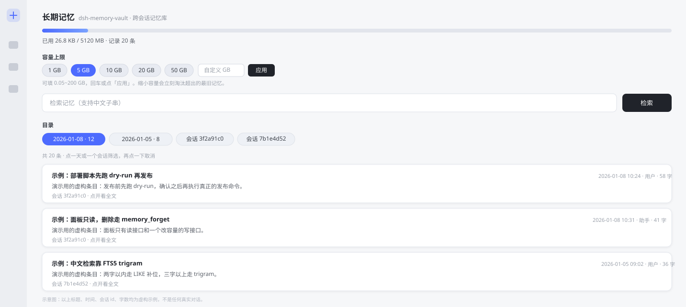

# dsh-memory-vault

给 DeepSeek Harness 加一个**跨会话的本地长期记忆库**：把你说过的话、助手答过的要点自动沉淀进 D 盘的一个 SQLite 文件里，每轮对话前按需检索一小段相关历史注入提示词，并用一个 Web 面板让你看到它到底占了多少空间。

零运行时依赖——只用 Node 24 内置的 `node:sqlite`（FTS5 trigram），不需要 `npm install`，不需要下载向量模型。



<sub>示意图，所有标题/会话 id/数字均为虚构示例。真实面板的外观由 `lib/client.js` 决定，可直接读源码。</sub>

---

## 它突破了什么，没突破什么

**没突破**：模型一侧的上下文窗口是硬上限，约 128K token（≈ 20 万汉字），这个数字由模型决定，插件改不了。
5GB 文本约 25 亿汉字 / 12.5 亿 token，是窗口容量的**一万倍**——「把这 5GB 一次全塞进上下文」在任何实现里都不存在。

**突破了**：把「窗口里能放下多少」换成「窗口里能取到多少」。库里任意一条记忆都取得到，而每取一次只花一两千字：

| 层 | 手段 | 一次花多少 |
| --- | --- | --- |
| ⓪ 压缩（只在新会话第一轮） | 每个过去会话压成两三行要点，一次注入 | 6 个会话约 900 字，只付一次 |
| ① 自动召回 | 每轮注入 3~5 条相关摘录，每条带 `id=` | 约 1500 字预算，可配 |
| ② 换词重搜 | `memory_search` 换关键词 / 加 `offset` 翻页 | 每条 220 字摘要，一次最多 20 条 |
| ③ 分段读全文 | `memory_open id=… chars=2400`，返回里带 `next` 接着读 | 一次 2400 字，最多 12000 |
| ④ 先看结构 | `memory_catalog` 给按天 / 按会话的目录 | 十几行 |

所以 5GB 不是「塞进窗口」，而是**一本可以逐页翻的书**：单次访问两三千字，读 20 页就是 6 万字，
相当于把窗口翻了一倍，而书架上还有 4.99GB。**代价是串行**：模型一次只能读一页，
跨全库的「整体统计 / 全局推理」仍然做不到，要靠摘要层预先压缩（见「已知限制」）。

**为什么不能靠「每次新会话都把上次的上下文读进来，于是翻倍、再翻倍」？**
因为窗口大小固定，读进来的原文不会变小：一个 5 万字的会话就吃掉 1/4 个窗口，读 4 个就满了。
能真正累积的只有两种东西——**被压缩过的**（⓪ 层，压缩率决定能堆多少个会话）和**用到才取的**（①②③ 层，每轮成本恒定）。
这个插件两层都有，但两层都不是「无限上下文」：它让**可检索的范围**无限，不是让**窗口里的字**无限。

它擅长的是「我们上次说过的那个部署脚本叫什么」这类**找回具体事实**的场景，而不是「把你的整个人生都记住并推理」——后者是模型能力问题，不是存储问题。

---

## 安装

```bash
git clone https://github.com/xying-lm/dsh-memory-vault.git
```

然后在 DSH 里把它装成一个 bundle：

```
plugin_manager install_bundle  target="file:<你的克隆路径>/dsh-memory-vault"
```

或直接在 GUI 里「设置 → 插件 → 安装插件」填入本地路径。

装好后**重启 DSH**（关窗口不算退出，托盘进程还在）：插件是 generation 快照拷贝，宿主启动时只 `import()` 一次，没有热重载通道。

默认库文件在 `D:\dsh-memory\vault.db`（macOS / Linux 落到 `~/.dsh-memory/vault.db`），可以在配置里改 `dbPath`。

---

## 七个工具

| 工具 | 用途 |
| --- | --- |
| `memory_search` | 在长期记忆里检索。支持中文整句当查询词，`offset` 可翻页。 |
| `memory_open` | 按 id 分段读一条记忆的全文（`chars` 控制每页字数，返回 `next` 接着读）。 |
| `memory_catalog` | 看库的整体目录：总条数、按天分布、最近的会话、时间跨度。 |
| `memory_save` | 显式记住一条（约定、偏好、关键决策）。默认长期；传 `mode: "multi"` 只本会话可见，`mode: "once"` 召回一次即删。 |
| `memory_stats` | 看用量：条数、占用、配额、当前档位、时间跨度。 |
| `memory_resize` | 改容量上限：给 `gigabytes: 5` 用常用档位，或 `2.5` 这样的自定义值（0.05~200）。立即生效、落库、重启不丢。 |
| `memory_forget` | 按 id 删掉一条（不可恢复）。 |

自动召回与这七个工具是**两条独立的路**：自动召回省事但可能漏，工具要模型主动调但问得准。两条都开着才稳。

### 三种记忆模式

| 模式 | 什么时候用 | 生命周期 |
| --- | --- | --- |
| `long`（长期，默认） | 约定、偏好、关键决策、踩过的坑 | 永久保留，跨会话可召回 |
| `multi`（多次） | 「这个项目这周先这么办」这类**只在本会话有效**的口径 | 只在写入它的那个会话里可召回；12 小时后自动清理 |
| `once`（单次） | 一次性的口令、临时编号、只想说一遍的事 | 被自动召回**一次**就从库里删掉（连正文都不留） |

自动采集的两条配置决定「自动记下来的」算哪种：`captureMode`（默认 `long`）；手动 `memory_save` 时由你传的 `mode` 决定（默认 `defaultMode`）。`memory_stats` 会显示库里三种模式各有多少条。

#### 在对话里直接换模式

输入框那一行、**「完全权限」控件的右边**有一个 `记忆 长期 ▾` 的小按钮（座位 `conversation.input.left`）。点开是三个选项：

- **长期** — 永久保存，任何会话都能召回
- **本会话** — 只在这个会话可见，12 小时后清掉
- **单次** — 被召回一次就删除，不留痕

选完立刻生效：**之后**这个会话的自动采集、以及模型调用 `memory_save` 时没显式传 `mode` 的，都按这个模式存。它只作用于当前会话，且只存在内存里（重启回到默认 `captureMode`）——不是全局设置，所以不会悄悄改掉别的会话。

> 要全局默认值，还是改配置里的 `captureMode` / `defaultMode`；输入框里这个是「这个会话怎么记」的临时开关。

### 对话文件：一条线索一个文件

记忆库是「一堆碎片」，而人聊事情是按线索走的。所以每次会话都会挂到一个**对话文件**上：

- 第一条消息时自动新建一个 `.md`（存在库目录的 `threads\` 下），文件名带日期与短标题，会话从此归这条线索；
- 输入框左边的「文件」按钮可以把它换成任意旧文件 —— 下一个会话挂上去，第一轮就会收到这行：

  ```
  【对话文件·续接】接着「修插件加载」这条线索（文件 …\threads\2026-10-21-修插件加载.md）：
  <最近 6 条要点的摘要>
  （这条线索共 12 条记忆；要原话用 memory_search 带 thread=3，或直接读这个文件。）
  ```

- **更直白的一步**：挂上旧文件后，你在新会话里说的第一句话会先换来一条**真实的用户消息**
  （`【对话文件·自动续接】…` + 上一个会话最后那条回答），它不是注入、不是注释，就是会话里的一条消息：

  ```
  【对话文件·自动续接】接着「修插件加载」这条线索（文件 …\2026-10-21-修插件加载.md）。
  上一个会话（a147bcec）最后一条回答：

  <那条回答的原文，默认最多 600 字>

  （这条线索累计 12 条记忆 / 2 个会话。直接说下一步要做什么就行。）
  ```

  这条消息由插件通过 `session.append('user/message', …, { surfaceOp: 'append' })` 落进会话日志，
  每个会话只发一次；它自己不会被再采集一遍（否则记忆库会被自己的续接话术污染）。
  不想要这一步就关 `threadAutoSend`，退回上面的隐形注入。
- 挂在旧文件上时，检索会**优先在这条线索内部**取两条再补全库 —— 「接着上次那个问题」靠的是线索内命中，而不是全库泛搜；
- 每条消息同时追加进那个 `.md`（人可读、可备份、可以丢进任何编辑器或 git），库里则记 `thread` 外键。

「突破上下文」在这里的真实边界：续接注入的是一份**摘要**（默认 600 字）而不是整条线索的原文，剩下的靠 `memory_search thread=…` 和 `memory_open` 按需取。窗口没变大，但「同一条线索的连续两次会话」不再从零开始。

---

## 配置

| 键 | 默认 | 说明 |
| --- | --- | --- |
| `enabled` | `true` | 总开关。关掉后不采集不召回，已有记忆保留。 |
| `dbPath` | `D:\dsh-memory\vault.db` | 库文件路径。面板「库位置」里改会写 `location.json`（优先于本项）并复制旧库；改写后需重启。 |
| `maxGB` | `5` | 自定义容量（GB）。仅当 `sizePreset = custom` 时生效。 |
| `sizePreset` | `custom` | 常用档位 `1` / `5` / `10` / `20` / `50`（GB），或 `custom` 用 `maxGB`。选档位时忽略 `maxGB`。 |
| `capture` | `true` | 自动沉淀对话。 |
| `captureAssistant` | `true` | 连助手回复一起记。关掉只记你说的。 |
| `captureMinChars` | `8` | 短于此字数的消息不记（「嗯」「好的」不占库）。 |
| `defaultMode` | `long` | 手动 `memory_save` 不传 `mode` 时用哪种：`long` / `multi` / `once`。 |
| `captureMode` | `long` | 自动采集的消息记成哪种。设成 `once` 会让自动采集的记忆被召回一次就删（一般不建议）。 |
| `skipSubagent` | `true` | 跳过子代理会话，避免把中间过程记成记忆。 |
| `recall` | `true` | 每轮自动检索并注入。 |
| `recallLimit` | `5` | 单轮最多注入几条。 |
| `recallMaxChars` | `1200` | 单轮注入的字数上限（占提示词预算）。 |
| `recallSnippetChars` | `160` | 单条摘录的字数上限。召回按「命中词所在那一句」截取，实际常只占一半。 |
| `recallMinQueryChars` | `4` | 输入短于此不检索。 |
| `recallSameSession` | `true` | 是否也取**当前会话**里更早的记忆。关掉则只跨会话召回。 |
| `recallRecentWindow` | `30` | 当前会话最近这么多条不参与召回（它们还在上下文里，重复注入只会挤占预算）。 |
| `sessionIndex` | `true` | 新会话第一轮注入一次「过去会话要点」（压缩层）。关掉则只靠检索按需取。 |
| `sessionIndexLimit` | `6` | 索引最多列几个过去会话（每个约 150 字，只在新会话第一轮付一次）。 |
| `threads` | `true` | 对话文件：每条线索写成磁盘一个 `.md`，会话可以挂到旧文件上接着聊。 |
| `threadResumeTurns` | `6` | 续接旧文件时，第一轮带回多少条最近记忆。 |
| `threadResumeChars` | `600` | 续接摘要的字数上限（只在挂旧文件的第一轮付一次）。 |
| `threadAutoSend` | `true` | 挂上旧文件后，把上一个会话最后那条回答自动发成一条**真实消息**（每个会话一次）。关掉退回隐形注入。 |
| `humanMemory` | `true` | 人类式记忆：三因子排序（相关度 × 显著性 × 时间衰减）+ 联想扩展 + 显著性回填。关掉退回纯 bm25 相关度。 |
| `factCards` | `true` | 巩固层：把跨会话反复出现的重点压成事实卡。召回时事实卡排在最前，并标 `· 事实卡`。 |
| `panel` | `true` | Web 侧边面板（含对话文件列表与库位置）。它会在宿主 Web 载体上新增 HTTP 面 `/memory-vault/*`（stats / search / recent / catalog / entry 只读，resize 是唯一的写路由且只改容量），随监听地址暴露（本机默认回环 127.0.0.1）。 |

配置非法会在**加载期**直接报错并指出是哪个键——不会带着错配置默默跑。

---

## 它怎么工作

```
对话 ──► session/event ──► 内存队列(1s 批量) ──► SQLite(mem + mem_fts)
                                                      │
下一轮输入 ──► systemPrompt.context(order=130) ──► 新会话第一轮：过去会话要点(压缩层，一次)
                                                └─► 每轮：检索 top-k（带 id）──► 注入当时的上下文
```

- **压缩层**（`sessionDigests`）：每个会话取最近 40 条，按「去重后的关键词数」给句子打分，挑两三句拼成要点。
  纯抽取式、不调模型，所以它抓的是字面重点，不会替你归纳。压缩率大约 1/20~1/50。

几个刻意的设计决定：

- **用 `context` 而不是 `systemPrompt.section`**：context 落在消息流里、每轮随对话变化，改它不会打断系统提示词的前缀缓存。
- **两层检索**：FTS5 trigram 负责 3 字以上的精确子串（`部署脚本`、`FTS5` 这类），查不到时用 2 字词在「最近 2000 条」窗口内补位——中文里最常见的重合恰好是 2 字（`杭州`、`部署`），trigram 结构上做不到，但不能因此漏掉。窗口有界，所以补位不会随 5GB 线性变慢。
- **自己的输出不再入库**：注入的召回块带 `【长期记忆·自动召回】` 标记，采集侧据此跳过。否则模型会把自己召回的内容当成用户的话再说一遍，再被记一遍，滚雪球。
- **去重靠内容指纹**：同样的内容（同角色 + 同正文）全局只存一份，重复出现只累加命中计数。

### 检索是两段式，召回是「按句付钱」

查询进来先拆词（拉丁词原样、中文按 4→3→2 字滑窗，最多 14 个）：

1. **FTS5 trigram**（`MATCH "词1" OR "词2"`，`bm25` 排序）——3 字以上的精确子串，几乎不误报；
2. **2 字词补位**（`LIKE`，只在最近 2000 条窗口内）——兜住「杭州」「部署」这类中文最常见重合，
   按「命中了几个不同的词」重排，所以双词命中会压过单词命中。

召回注入这一侧做了五件事，目标都是「同样的召回质量，更少的字」：

| 手段 | 效果 |
| --- | --- |
| **按句摘录**（`makeFocusSnippet`） | 只取「命中词所在的那一句」，并一句上下文；长文平均 40~90 字，而不是固定 220 字窗口 |
| **分层预算** | 第 1 条 220 字、第 2 条 160、第 3 条 120，之后 90/80 —— 长尾只是字面擦边，不值得和首条同价 |
| **结果去重**（`dropDuplicates`） | 两条摘录共享一半以上双字词就合并，同一段话不付两次钱 |
| **低信息跳过** | 「好」「继续」「谢谢」这类应答不触发检索——翻旧账的命中率极低，注入了也是噪音 |
| **尾注只说一次** | 「库内共 N 条 / 怎么继续取」每会话说一遍就够；本轮新写入的消息也不会被自己召回 |

实测（38 条真库、5 条真实查询）：旧渲染 6112 字 → 新渲染 3879 字，**省 37%**；单轮从约 900 token 降到约 580 token。
再叠加「长查询少给两条」（查询超过 60 字只取 3 条）和「一轮注入过的 id 不再重复注入」，
连续多轮同主题对话的平均成本还会更低。

### 像人一样记：三个机制，以及它们不像人的地方

| 机制 | 模仿什么 | 实现 |
| --- | --- | --- |
| **三因子排序** | 遗忘曲线 + 情绪唤醒 | `相关度 × (0.55 + 0.45×显著性) × 0.5^(天数/半衰期)`；半衰期 = `60 + 400×显著性` 天（下限 0.45）。「记住」「必须」「以后都」这类说法会把显著性顶上去，于是更难被忘掉 |
| **联想扩展** | 邻近激活（想起 A 就带出同一场景的 B） | 入库时把同会话相邻 12 条、共享至少 2 个关键词的记忆连成一条边（权重 = 共享词数）；召回时给前两条命中各带一条最强的邻居，标 `· 关联` |
| **巩固层** | 睡眠时把情景压成语义 | 每 10 分钟聚一次：按「共享任意两个关键词」并用查体系聚类，凡横跨 **≥2 个会话**且反复出现的组，抽一句压成事实卡；召回时事实卡排最前，标 `· 事实卡` |
| **单次记忆** | 工作记忆 | `once` 模式注入后立刻删除；`multi` 只在 12 小时内、本会话内可见 |

三条边界必须说清楚：

- **没有向量嵌入**，所以抓不到换说法（「部署脚本」和「发布流程」在它眼里无关）。这是为了避免引入 embedding 依赖；
- 巩固层是**抽取式**的，它只会把反复出现的原句挑出来，不会真的归纳出「用户偏好先给结论」这种抽象结论；
- 显著性靠词表判断，会误判——一段话里出现「记住」就可能被永久抬权。所以 `humanMemory` 可以整体关掉，回到纯相关度排序。

---

## Web 面板

侧栏面板图标「长期记忆」→ 中央面板，七个部分：

- **用量条**：已用 / 上限（MB）、百分比、记录条数、库文件路径、最新写入时间。
- **容量上限**：`1 / 5 / 10 / 20 / 50 GB` 五个常用档位一键切换，也能填任意自定义值（`0.05~200`）；改完立即生效并落库，重启不会被配置文件覆盖回去，想回退点「恢复配置值」。
- **检索框**：和 `memory_search` 走同一条检索路径，回车即查，结果显示标题 / 时间 / 角色 / 字数 / 摘录。
- **目录**：按天、按会话两种切片各给一排标签（`2026-10-20 · 23`、`会话 a147bcec · 13`），点一下只看那一组，再点一下取消。库里的条目再多，也是先收窄再翻，不用滚一整天。
- **列表 + 点开全文**：默认 20 条一页（按时间倒序），底部「加载更多」继续翻；每张卡片本身就是按钮 —— 点一下按需取该条全文展开（最多 320px 高、可滚动），再点收起。列表接口故意不带正文，所以翻页再快也不会把整库拖进浏览器。
- **对话文件**：当前会话挂在哪条线索上、以及最近 8 条线索的「几个会话 / 几条记忆」。
- **库位置**：库文件放在哪、是否为自定义位置；可填新路径「应用」（会把旧库复制过去，重启生效）或「恢复默认」。

数据来自宿主半边的路由：

```
GET  /memory-vault/stats
GET  /memory-vault/search?q=<词>&limit=10
GET  /memory-vault/recent?limit=20&offset=0[&day=2026-10-20][&session=<id>]
GET  /memory-vault/catalog                 # 目录：按天 / 按会话的条数索引
GET  /memory-vault/entry?id=<id>           # 单条全文（点开卡片时才请求）
GET  /memory-vault/session-mode?session=<id>   # 本会话当前的记忆模式
GET  /memory-vault/threads[?session=<id>]  # 对话文件列表 + 本会话挂的那个
GET  /memory-vault/thread?id=<id>           # 某条线索的摘要
GET  /memory-vault/location                # 库文件当前位置
POST /memory-vault/resize   {"gigabytes": 10}   或   {"reset": true}
POST /memory-vault/session-mode   {"session": "<id>", "mode": "long|multi|once"}
POST /memory-vault/threads        {"title": "可选"}
POST /memory-vault/session-thread {"session": "<id>", "thread": 12}
POST /memory-vault/location       {"path": "D:\\new\\vault.db"} 或 {"reset": true}
```

读接口只读、不读凭据；`/recent` 无论带不带筛选与 `offset` 都会回 `total`（面板靠它算「还有 N 条」）。写接口有五个，都碰不到任何一条记忆的正文：`/resize` 改容量上限，`/session-mode` 改「这个会话之后怎么记」，`/threads` 新建线索，`/session-thread` 把会话挂到线索，`/location` 换库文件位置（只复制文件，不删旧库）。整块面板注册失败也只会让面板缺席，不影响采集 / 召回 / 工具。

---

## 与既有插件的关系

| 插件 | 负责 | 与本品关系 |
| --- | --- | --- |
| `billion-context` | 会话**内**压缩 | 互补：它管窗口装不下时怎么办，本品管窗口外的东西怎么找回来 |
| `dsh-recall-plugin` | 消息撤回 | 无关，可共存 |

---

## 已知限制

- 检索是**字面匹配**（trigram + 双字词），不做语义理解。「那台跑 CI 的机器」找不到「构建服务器」，除非两者共享字面。这是零依赖、零模型的代价；要语义检索就得引入 embedding 模型（几百 MB 权重 + 常驻内存）。
- 会话索引的摘要是**抽取式**的（挑关键词最密集的句子），不做语义归纳；要真摘要得让模型自己写，那是另一档成本（要调模型、要花钱、还要处理摘要漂移）。`- **访问是串行的**：`memory_open` 一次读一页，模型要读 20 页就得多调 20 次工具。跨全库的「一共提过几次 X」「把这 5GB 归类总结」做不到——那需要预先写摘要（本插件没做，因为摘要要调模型、要花钱、要处理摘要漂移）。
- 单条记忆上限被配额约束（约配额的 5%），超长文档会被截断。
- 换 `dbPath` 不迁移数据；换之前请先复制 `vault.db`（连同 `vault.db-wal`、`vault.db-shm`）。
- 面板是**只读**的：看用量、检索、看最近写入，不能在面板里删除或编辑记忆（删除走 `memory_forget` 工具）。
- **装完必须彻底重启宿主**才生效：profile 里的插件是按 generation 快照拷贝的，宿主进程不会热加载新代码。关窗口不算退出——托盘图标还在跑，要从托盘菜单退出。
- 容量调整（面板档位 / 自定义 / `memory_resize`）改的是**上限**，不会立刻删除已有记忆；只有写入后超限才会按「最久未用 + 最旧」淘汰。

---

## 数据在哪、怎么备份

```
D:\dsh-memory\vault.db        主库
D:\dsh-memory\vault.db-wal    预写日志（备份要一起带上）
D:\dsh-memory\vault.db-shm    共享内存索引
```

取消插件前先停掉会话，再整目录复制，否则可能拿到半写状态的库。

## 开发与测试

零依赖，不用 `npm install`（Node 24 自带 `node:sqlite`）。五个测试文件全是自包含脚本，跑的是临时库 + 真 `node:http`，不碰你的真实记忆库：

```bash
npm test          # 270 项断言：存储 66 + 容量 37 + 面板 44 + 客户端渲染 40 + 客户端交互 29 + 插件装配 54
node test/panel-test.mjs   # 也可以单跑某一个
```

`test/plugin-smoke.mjs` 用假 `ctx` 跑通 `apply()` 全链路；设 `VAULT_ROOT=<已安装的 generation 目录>` 可以直接验装好的那一份副本。

## License

MIT © 2026 xying-lm